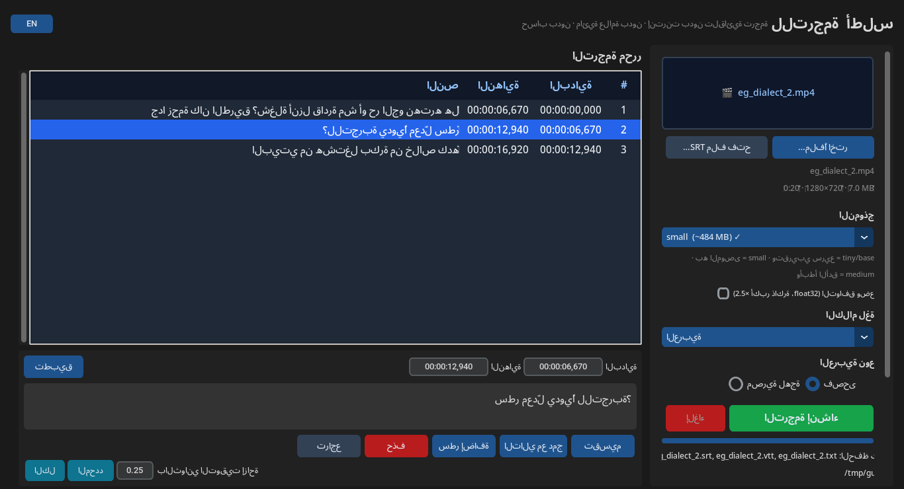

# أطلس للترجمة · Atlas Subtitles

**ترجمة (سَبتايتل) تلقائية للفيديو — مجانية، بدون إنترنت، بدون علامة مائية، بدون حساب.**
بديل مجاني لميزة الترجمة التلقائية المدفوعة في CapCut، والعربية أولًا.




## المميزات
- تفريغ الكلام إلى نص تلقائيًا على جهازك (faster-whisper) — الفيديو لا يُرفع لأي مكان.
- عربي فصحى بجودة جيدة، واللهجة المصرية «أفضل محاولة» (اختيار «لهجة مصرية» يساعد قليلًا). إنجليزي ولغات أخرى أيضًا.
- نماذج بأحجام مختلفة: tiny / base / small (الموصى به) / medium (الأدق). يُنزَّل النموذج مرة واحدة فقط ثم يعمل بدون إنترنت.
- محرر للترجمة: تعديل النص والتوقيت، تقسيم سطر، دمج سطرين، إضافة/حذف، تحريك توقيت الكل أو المحدد، تراجع (Ctrl+Z).
- تصدير SRT و VTT و TXT، ودمج الترجمة داخل الفيديو (Burn-in) بخط عربي سليم (Noto Sans Arabic أو Amiri) مع خلفية داكنة اختيارية.
- يدعم الفيديوهات الطويلة (تقسيم تلقائي كل 10 دقائق) مع شريط تقدّم وزر إلغاء.
- واجهة عربية (من اليمين لليسار) أو إنجليزية بضغطة زر.

## التشغيل على ويندوز
1. نزّل `Atlas_Subtitles_Win.zip` من صفحة Releases وفك الضغط.
2. شغّل `Atlas_Subtitles.exe`. أول مرة قد يظهر تحذير SmartScreen لأن البرنامج غير موقّع: **More info → Run anyway**.
3. اسحب فيديو إلى البرنامج ← اختر النموذج واللغة ← «إنشاء الترجمة».

التفاصيل في [دليل الاستخدام MANUAL.md](MANUAL.md).

## ملاحظات صادقة عن الدقة
تم القياس على مقاطع حقيقية (التفاصيل في [tests/RESULTS.md](tests/RESULTS.md)). الفصحى المقروءة جيدة جدًا مع small/medium،
الكلام البشري الطبيعي أصعب، واللهجة المصرية تخرج غالبًا مفهومة لكن بأخطاء إملائية/لهجية — راجع النص في المحرر قبل النشر.

---

# Atlas Subtitles (English)

Free, offline, no-watermark automatic subtitles for videos on Windows — Arabic-first (Egyptian dialect best-effort).

- On-device speech recognition (faster-whisper, CPU). Models download once on first use (tiny 75 MB … medium 1.5 GB).
- Subtitle editor: edit text/timing, split, merge, add, delete, shift all/selected, undo.
- Export SRT / VTT / TXT; burn subtitles into the video with correctly shaped Arabic (libass + bundled fonts).
- Long files are processed in 10-minute chunks with progress and cancel.
- Arabic (RTL) or English interface.

See [MANUAL.md](MANUAL.md) for usage and [tests/RESULTS.md](tests/RESULTS.md) for measured accuracy and speed.

## Run from source
```
pip install -r requirements.txt        # Python 3.10+ ; FFmpeg must be on PATH or next to the app
python run_gui.py                      # GUI
python run_cli.py video.mp4 --model small --lang ar --burn     # command line
python -m pytest tests/test_core.py    # unit tests
```

## Build the Windows app
GitHub Actions → **Build Windows** (manual run, or push a tag `v*`). It installs the dependencies, runs the unit tests,
downloads FFmpeg (BtbN win64 GPL build), builds a PyInstaller one-folder app with `scripts/build-windows.ps1`,
smoke-tests the built exe (bundled ffmpeg + model download + GUI start) and uploads `Atlas_Subtitles_Win.zip`.

## License
The app's own code is **MIT** — see [LICENSE](LICENSE). Third-party components (FFmpeg, models, fonts) keep their own
licenses — see [NOTICE.md](NOTICE.md). Note: the Windows zip ships the BtbN **GPL** FFmpeg build as separate
`ffmpeg.exe` / `ffprobe.exe`; its license text is included as `FFmpeg-LICENSE.txt` and its source is linked in NOTICE.md.
